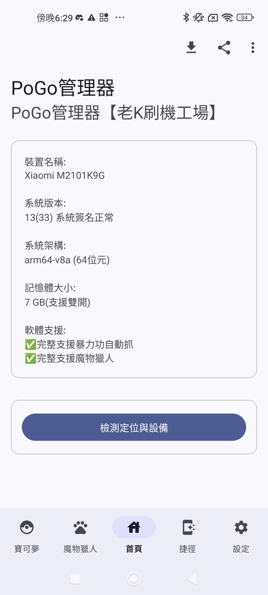
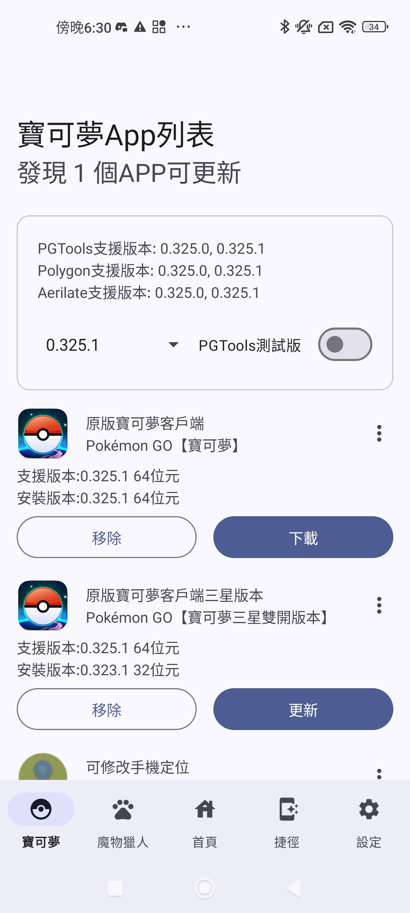
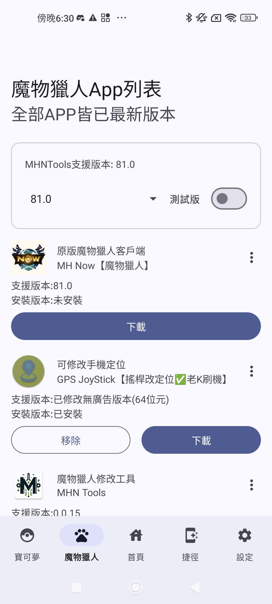

# POGO Manager

[繁體中文](README.md) | English

POGO Manager is an Android application for managing companion apps for Pokémon GO, Monster Hunter Now, and Pikmin Bloom. It provides version checks, compatibility information, download links, and device diagnostics. The interface and user guides are primarily in Traditional Chinese.

## Features

- App management: check installed and available versions, access downloads, and open apps, app settings, or system uninstall prompts.
- Version compatibility: compare companion-tool support against a selected game version, with stable and test channels for PGTools and MHNTools.
- Device diagnostics: display system information, location status, and root/Magisk indicators, with links to external integrity and environment checkers.
- Utilities: user guides, a cooldown calculator, launcher shortcuts, and a location-settings widget.
- Interface: dark mode, dynamic colors, and phone and tablet layouts.

## Supported games

| Game | Integrations |
| --- | --- |
| Pokémon GO | Game-version selection, PGTools/Pokemod/PGSharp Root compatibility checks, and companion-app versions and downloads |
| Monster Hunter Now | Game-version selection, MHNTools stable/test compatibility checks, and companion downloads |
| Pikmin Bloom | Game, location and step tools, Google Fit, Health Connect, and installation tools |

Version and compatibility checks vary by integration. See the [integration and usage guide](docs/app-guide.en.md) for the full catalog and limitations.

## Requirements

- Android 9 (API 28) or newer.
- Internet access for version checks and downloads.
- Most game and tool downloads are restricted to `arm64-v8a` devices by default. Bypassing this check does not change an APK's architecture requirements.
- Basic version checks do not require root. Individual companion tools may require root, LSPosed, or a specific Android version.
- Location checks require location permission and enabled location services.

The application integrates Google Mobile Ads, OneSignal notifications, and Google Play services location.

## Installation

Download an APK from [GitHub Releases](https://github.com/lokey0905/POGO_Manager/releases) and follow Android's installation prompts. This README covers the current source tree; consult the release notes for features included in each published build.

Locally built and published APKs may use different signing certificates. Check whether an in-place update is possible before installing. See the [installation guide](docs/app-guide.en.md#installation) for permissions, installation details, and historical backups.

## Screenshots

<details>
<summary>Historical screenshots</summary>

These screenshots are from earlier releases and differ from the current interface.





</details>

## Development and building

The project uses Kotlin and Java, with AndroidX Fragments, XML layouts, View Binding, and Material Components for the interface. Network communication and asynchronous operations use OkHttp, Coroutines, and Protocol Buffers. Some device checks use C/JNI and an isolated service, built with CMake.

Install Git, JDK 21, the Android SDK, NDK, and CMake. Toolchain versions and SDK configuration are documented in the [Gradle configuration](app/build.gradle) and [development guide](docs/development.en.md). Initial setup requires downloading the toolchain and dependencies.

Run from the repository root:

Windows PowerShell:

```powershell
.\gradlew.bat :app:assembleDebug :app:testDebugUnitTest
```

Linux/macOS:

```sh
chmod +x gradlew
./gradlew :app:assembleDebug :app:testDebugUnitTest
```

The debug APK is written to `app/build/outputs/apk/debug/app-debug.apk`. See the [build documentation](docs/development.en.md#building-from-source) for signing, memory settings, and testing instructions.

## Maintenance

Maintenance covers Android compatibility, upstream version parsing and download sources, dependency updates, crash fixes, and UI changes. Upstream service changes may affect version checks or downloads. Pending work is tracked in [TODO.md](TODO.md); test results are listed in the [validation notes](docs/development.en.md#maintenance).

## Contributing

Submit bug reports and feature requests through [Issues](https://github.com/lokey0905/POGO_Manager/issues). Read [CONTRIBUTING.md](CONTRIBUTING.md#english) before submitting a pull request, and include a description of the changes and test results. Discuss substantial feature or architectural changes in an issue first.

## Documentation

- [User guide index](docs/README.md)
- [Pokémon GO](docs/pokemon_go.md) · [Monster Hunter Now](docs/monster_hunter_now.md) · [Pikmin Bloom](docs/pikmin_bloom.md) · [Location tools](docs/location_only.md) — guides in Traditional Chinese
- [Integration and compatibility guide](docs/app-guide.en.md)
- [Development and build instructions](docs/development.en.md)

## Third-party software

Sources and license notices for third-party code, assets, and dependencies are recorded in [THIRD_PARTY_NOTICES.md](THIRD_PARTY_NOTICES.md). Development references and external tools are listed separately in [References](docs/references.md).

## Disclaimer

This is an unofficial community project, with no affiliation with or endorsement by the games' publishers or rights holders. Third-party trademarks and icons belong to their respective owners. Device checks and version information are provided for reference and do not guarantee device security or protection from account restrictions. Users must comply with applicable laws and service terms. See [DISCLAIMER.md](DISCLAIMER.md#english) for the full statement.

## License

No project-level license has been adopted.

Third-party material remains subject to its respective licenses. See [THIRD_PARTY_NOTICES.md](THIRD_PARTY_NOTICES.md) for scope and unresolved questions.
